# TamaPoke

[](https://reallyjustsomeguy.github.io/TamaPokeLANExp/web/)
[](https://makerworld.com/es/models/2937822-tamapoke-a-pokemon-pokeball-tamagotchi)


[](https://github.com/DylanPDao/TamaPoke/stargazers)

A gen-1-Pokémon-inspired tamagotchi for the
**Waveshare ESP32-S3-Touch-AMOLED-1.75** (round 466×466 AMOLED, CO5300 driver
over QSPI, CST9217 touch over I2C). Raise any of the 1025, evolve it, train it
and complete them all (shinies included).

> ### 🙏 This is a fork of a fork: [**socquique/TamaPoke**](https://github.com/socquique/TamaPoke) → [**DylanPDao/TamaPoke**](https://github.com/DylanPDao/TamaPoke) → here
>
> Quique Tortosa wrote the original TamaPoke — the firmware, the sprite
> pipeline, the six-language UI, the web installer, the whole thing. Dylan Dao
> forked and extended it (Kalos/Alola, several real-hardware save-corruption
> fixes). This fork builds on both; it did not start any of it. If you like
> this, go star **[the original](https://github.com/socquique/TamaPoke)** and
> **[Dylan's fork](https://github.com/DylanPDao/TamaPoke)**.
>
> Original: MIT © 2026 Quique Tortosa. Changes in this fork and in Dylan's are
> MIT on the same terms.

> **Personal, non-commercial fan project.** Code is MIT; the sprites are from
> PMD SpriteCollab (CC BY-NC, Pokémon © Nintendo/Game Freak), and the 3D case is
> CC BY-NC-SA. See **[License](#license)** and **Credits**.

🔴 **3D-printed Pokéball case + print profiles → [on MakerWorld](https://makerworld.com/es/models/2937822-tamapoke-a-pokemon-pokeball-tamagotchi)** · flash it in your browser → **[web installer](https://reallyjustsomeguy.github.io/TamaPokeLANExp/web/)**

## Status

Running on hardware. Implemented: 1025 species + shinies animated from microSD, full
life cycle (egg by rarity → evolution → farewell/release/runaway, each gated
behind a decision dialog), bred-Pokédex with gallery, turn-based trainer, wild
and LAN battles, **wild capture and a shared bag**, battle stats (IVs +
training), retention hooks (streak / bond / medals / name), biome + real-time
backgrounds, ball minigame, training bag, animated bath, RTC with offline
progression, battery (AXP2101) and PWR button, anti-burn-in dimming,
**sound (ES8311)**, **6 UI languages (English default)**, **starter choice on
first run**, and a one-click **web installer**.

All nine regions are in the dex. **Galar and Paldea have no sprite pack yet**, so
they show as NEEDS PACK and stay out of the egg pool until one is built — the
same gating every region has always used.

**Added in this fork:**

- **LAN battles are fully working now** — scan for and battle another player
  head-to-head over WiFi Direct (no router or home WiFi needed!), with
  win/loss records kept per rival.
- **The Poké Mart** — spend real steps, turned into Pokédollars, on balls,
  potions and vitamins between EXPLORE and the gyms.
- **A pedometer** drives it, with no extra battery draw — the QMI8658's own
  onboard step-counting engine never worked reliably on this board, so
  steps are detected from the same accelerometer readings instead.
- **`tools/debugger/`** — a live serial monitor + save editor for testing
  against real hardware. Not part of the firmware itself.
- **From [vunguyen2712's fork](https://github.com/vunguyen2712/TamaPoke):** the
  **daycare**, **held items** with **Pokédex rewards** and the **Shiny / Oval
  Charms**, and **daily / weekly tasks** — re-built on this fork's save format,
  so a v3.28 save upgrades in place (`tools/emu/tests/upgrade328_test.cpp`
  proves it against a save the real v3.28 firmware wrote).

## Screens

All shots are straight off the 466x466 round panel, rendered headlessly by the
emulator (`tools/emu/tamapoke-emu --shot <name>`), so they are exactly what the
hardware draws.

### Starting out

| Pick a region | ...then its starter | Johto's three |
|---|---|---|
| 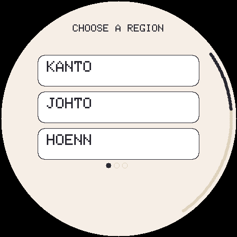 | 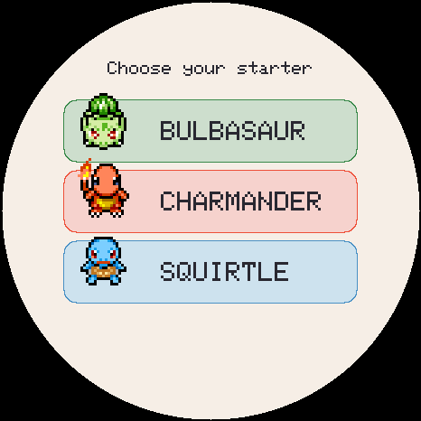 | 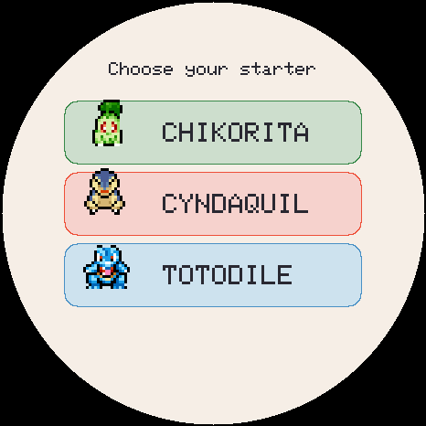 |

A new game asks which region you are playing before it asks which creature you
want. The choice sets both: you pick from that region's three starters, and it
becomes where your eggs come from afterwards (changeable later on the egg's
region pill). Existing saves never see this screen — it only appears when the
Pokédex is empty.

### Raising one

| Your creature | Its egg | Moves it knows |
|---|---|---|
| 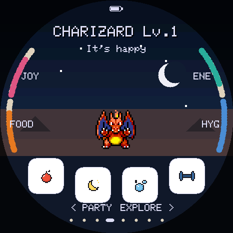 | 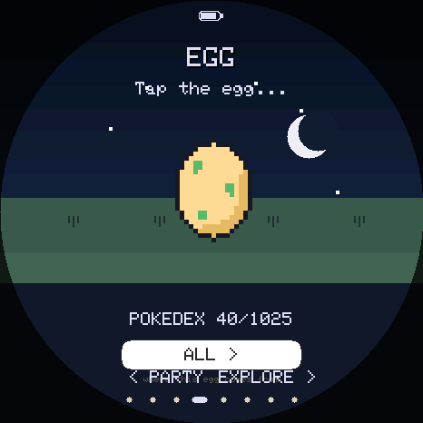 | 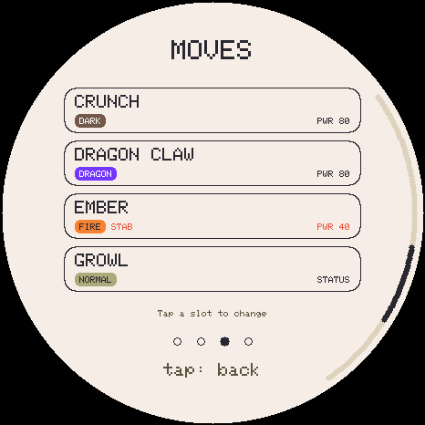 |

The egg carries a **region pill** — pick which of the nine regions it hatches
from, or ALL for the mixed pool. Switching keeps the rarity it was granted and
remembers each region's answer, so it cannot be flipped to farm a legendary.
Regions with no sprite pack installed are skipped rather than offered.

### Battling

| The fight | Choosing a move | Choosing a team | Winning |
|---|---|---|---|
| 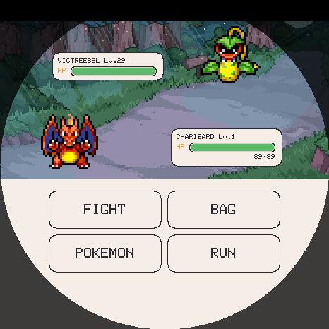 | 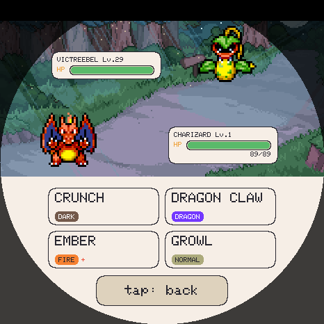 | 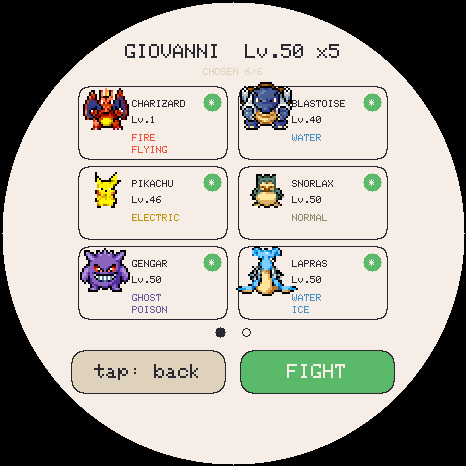 | 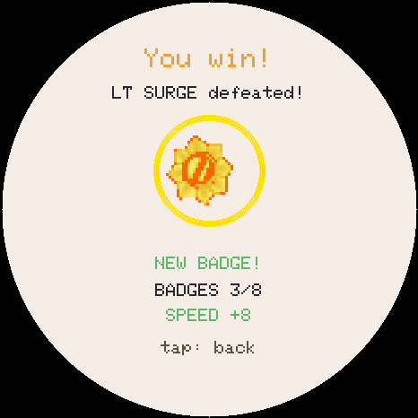 |

Turn- and move-based, with the real type chart, ailments and STAB. Moves sit in a
2x2 grid with each one's type and remaining uses. Real Game Boy battle music
plays throughout.

### Seven gym ladders

| Pick a ladder | Johto's gyms | LAN battle |
|---|---|---|
| 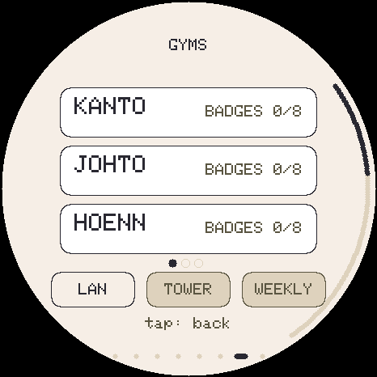 | 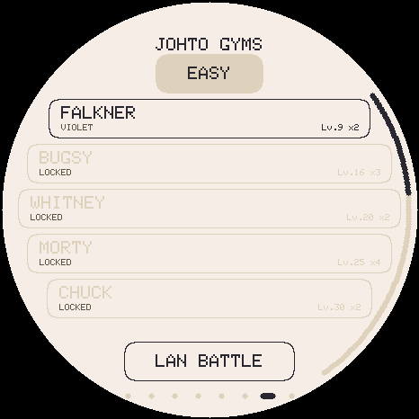 | 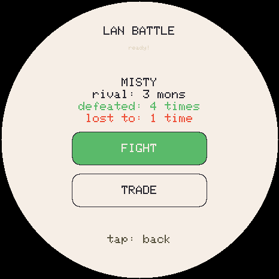 |

Kanto, Johto, Hoenn, Sinnoh, Unova, Kalos and Alola each have eight leaders, an
Elite 4 and a champion, on easy and hard. Four of the seven are the games' own
teams, checked against the pokecrystal, pokeemerald and pokeplatinum
disassemblies — **0 differences across all 39 verified trainers**, re-checkable
with `tools/verify_rosters.py`.

**Unova, Kalos and Alola are the exceptions, and say so.** pret's work stops at
the DS generation, so those three ladders are written from knowledge rather than
from the games' own tables; `verify_rosters.py` prints each of them as NOT
VERIFIED rather than letting a clean run imply otherwise. Unova follows Black 2 /
White 2, which unlike Black/White has no version- or starter-dependent leaders.

Galar and Paldea are in the dex but have no ladder, because they have no sprite
pack — see § Status.

Sinnoh follows **Platinum**, where Fantina is the *third* gym rather than
Diamond/Pearl's fifth; the level ramp only runs 14/22/26/32/37/41/44/50 that
way. Same reasoning that makes Hoenn Emerald throughout.

### Exploring

| Choose where to hunt | A wild encounter |
|---|---|
| 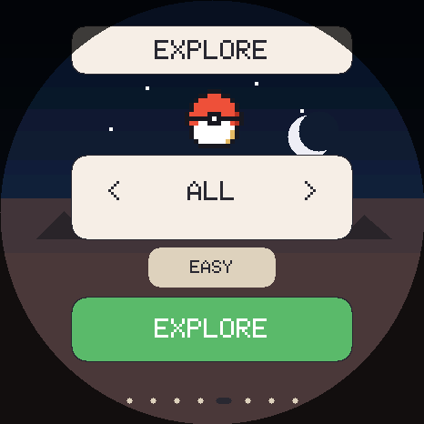 | 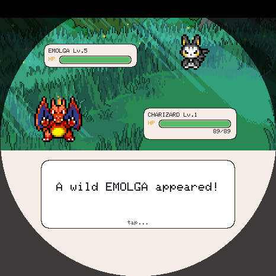 |

Wild creatures are met by exploring rather than only in gyms. The `< REGION >`
selector picks where the next encounter comes from, independently of your egg's
region, so changing hunting grounds never rerolls or moves the egg. Regions whose
sprite pack is not installed are skipped. Weaken one and throw a ball to keep it;
a caught creature goes to the party or the box, and does *not* fill the Pokédex
until you actually raise it.

### The Poké Mart

| The catalogue | Buying something |
|---|---|
| 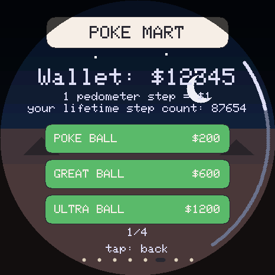 | 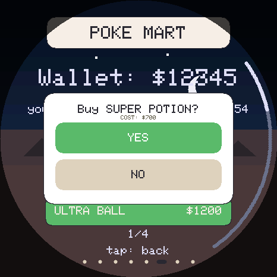 |

Sits between EXPLORE and the gyms on the tile axis. Real steps become
Pokédollars at 1:1 — see § Game manual below for the wallet cap and price list.

### Collecting

| Pick a region | Kanto | Johto |
|---|---|---|
| 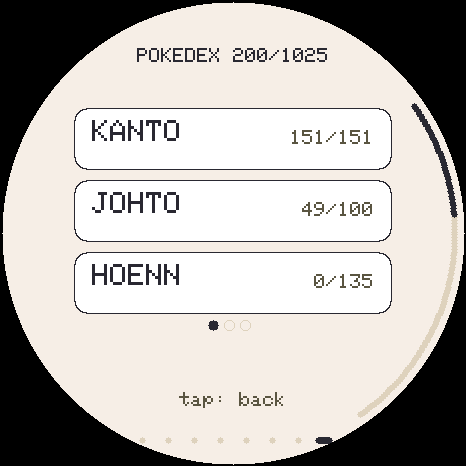 | 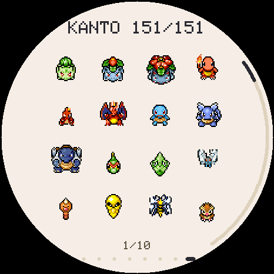 | 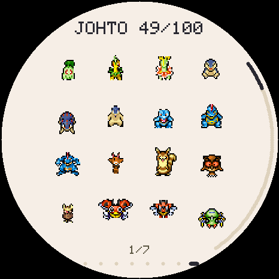 |

| Trainer card | Johto badges | The box |
|---|---|---|
| 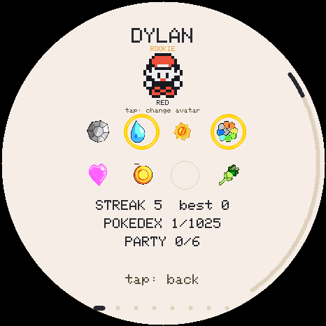 | 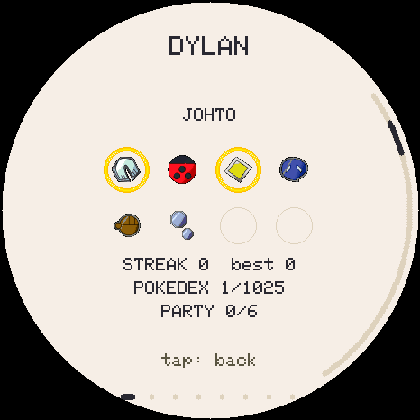 | 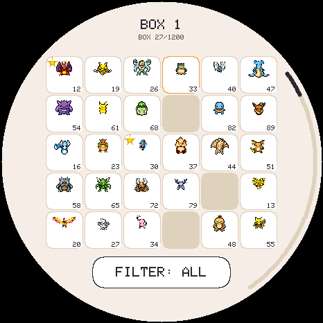 |

## Game manual (the actual numbers)

A quick reference to how the game really works (values straight from the code).

### Controls

The round panel has no corners to anchor a back button, so touch gestures carry
the navigation — three axes, one meaning each, everywhere:

| Gesture | Means |
|---|---|
| **Horizontal swipe** | move along the **tile axis**: `PLAYER · DAYCARE · PARTY · [PET] · EXPLORE · MART · GYM · POKÉDEX`. It **bumps** at both ends and never closes anything. |
| **Swipe up** | go **deeper** — from the pet, its stat card |
| **Swipe down** | go **back**, one level, from anywhere |
| **Drag the rim** | **page** whatever is in front of you (the arc scrollbar at 2–5 o'clock) |

- **Tap the name** at the top opens the **menu** (Pokédex / Bag / Settings).
- **Tap the creature** to pet it. **Long press (3 s)** opens the **release**
  dialog — gated to the main screen only, so it can never fire on a party slot.
- **Maximum brightness:** Settings has a **LIGHT 1-10** row (the sun) under
  the clock. 10 is the full panel; each step lower is dimmer. Everything that
  dims the screen still works underneath it: sleeping, and the idle dims after
  1.5 and 5 minutes, are always at most two thirds of the maximum you chose,
  so a sleeping creature still visibly darkens the screen even at LIGHT 1.
  The setting is kept across reboots and travels in the save backup.
- **Physical PWR button:** short press = screen on/off · long press (4 s) =
  full power-off (the RTC keeps running, so time still passes while it's off).

### Time & leveling

- **1 real minute = 1 in-game minute.** Your Pokémon gains **+1 level every hour**
  of real time. Leveling is purely time-based — caring well doesn't speed it up,
  but neglect *delays evolution*.
- **Level caps at 100**, reached at 4 days 3 hours. Farewell is only *offered* at
  3 days (level 73) — **not a deadline**: your Pokémon is still growing, and
  declining it to reach 100 is a real choice. Declining re-offers a day later.
- It keeps **aging while powered off** (the RTC runs), catching up to **2 weeks** max.

### The four stats (0–100)

Needs: **FOOD**, **JOY**, **ENE** (energy), **HYG** (hygiene). Start 80 / 80 / 80 / 100.
While **awake**, per minute:

| Stat | Drain/min | Notes |
|---|---|---|
| FOOD | −2 | |
| ENE | −1 | −1 extra if overweight (weight > 50 → sluggish) |
| HYG | −1 | **−4 more per poop** on screen (max 3 poops) |
| JOY | −1 | **−2 extra** if FOOD < 30, **−2 extra** if HYG < 30 |

- ~**15 %/min** chance to poop (only if FOOD > 40). Poops tank hygiene fast.
- **Care slip-up** = letting any stat hit **≤ 10** (60-min cooldown so it counts once).
  Each slip-up **delays evolution by 1 level** and cools the bond by 1.

### Actions

- 🍎 **Berry** (3 flavors): +25 FOOD. Each species has a **hidden favorite flavor**
  → +35 FOOD, +10 JOY, ♥, bond, and it gets revealed.
- 🍬 **Candy:** +10 FOOD, +12 JOY, but **+12 weight** (fattening).
- ⚽ **Play / minigame:** **+5 JOY, plus 2 per rally** (max +35), −ENE, burns
  weight. Pure happiness — it trains nothing, so playing is never a stat grind.
  Leaving early keeps what you earned.
- 🎯 **Reaction test:** a target appears, tap it before it shrinks away. Trains
  **SPEED**; the window tightens as you go.
- 🥊 **Training bag:** trains **STRENGTH** (~4 hits = 1 pt, cap +18/session), tires it.
- 🫧 **Bath:** clears poops, HYG → 100.
- 👆 **Pet it:** +5 JOY + bond.
- 🌙 **Sleep:** rest — ENE **+6/min**, needs drain ~**4× slower** with floors
  (FOOD 30 / JOY 35 / HYG 45). No poops, no slip-ups, can't run away while
  asleep. **Screen off between midnight and 06:00 puts it to sleep**, and it
  stays asleep until you turn the screen back on — it wakes when *you* do, not
  at a fixed hour. The light button always overrides: a creature you sent to
  bed stays there regardless of the clock.

### Eggs & who you get (spawn odds)

- Hatch the egg: tap it **3×** (or wait — it hatches on its own).
- Every later egg rolls a **rarity tier** (over the ~79 base forms that come from eggs):

| Tier | Base chance | After a proper goodbye | # species |
|---|---|---|---|
| ✨ Legendary | ~3 %\* | ~10 % | 5 |
| 🔵 Rare | ~27 % | ~45 % | 27 |
| ⚪ Common | the rest | the rest | 47 |

  \* Legendaries only start appearing once you've **registered ≥ 25** Pokémon.
- A daily **streak** and high **bond** push rare/legendary odds higher.
- A clean **goodbye blesses** the next egg; a **run-away curses** it (forces Common).
- Within a tier it favors species whose **evolution line you haven't finished** (so
  all 1025 are completable).
- **Shiny:** base **1 / 48** (→ **1 / 24** right after a goodbye), improved by
  streak/bond down to a best of **1 / 8**. Tracked separately in the dex.
- Every hatch rolls unique **IVs** (see below) — no two are identical.

### Evolution and moves

- Triggers when **level ≥ its evolution level** (16 for most base forms; ~25
  for friendship-style like GOLBAT → CROBAT, ~30 for stone-style, ~40 for
  trade-style like SCYTHER → SCIZOR) **and every stat ≥ 40** at that moment.
- **Never automatic** — a button appears and **you tap to witness it** (with a
  flicker between the old and new form). Each **slip-up delays it by 1 level**.
- You can **decline** ("keep form"); it re-offers at the next level.
- **Friendship evolutions** need the **bond** too. Golbat, Chansey, Pichu,
  Cleffa, Igglybuff, Togepi, Azurill, Budew, Buneary, Chingling, Happiny,
  Munchlax, Riolu, Woobat, Swadloon and Type: Null keep their level **and**
  need **bond ≥ 50**; the stat card shows `BOND n/50` while it is the bond
  holding them back. A card without the target's sprite pack says `NEEDS PACK`
  instead of `READY`.
- A **bonded Eevee** (bond ≥ 50) becomes **Espeon** by day and **Umbreon** at
  night (18:00–06:00). Unbonded, it never takes either of those two.
- *Eevee* branches toward whichever of its **eight** evolutions you're still
  missing — Vaporeon, Jolteon, Flareon, Espeon, Umbreon, Leafeon, Glaceon and
  Sylveon. None of the eight hatches from an egg any more: the only way to a
  Sylveon is to raise an Eevee. A branch is offered only if that region's
  sprite pack is on the card, so evolving can never hand you a creature the
  device cannot draw.

Each creature also knows up to **4 moves**, from a pool of 77. Two kinds:

- **Level-up moves** are gated: Charizard learns FLAMETHROWER at 34, WING ATTACK
  at 36, DRAGON RAGE at 54. A hatchling starts with **only** what its species
  knows at level 1 — a Charmander opens with GROWL alone, and the other three
  slots stay empty. Crossing a gate fills an empty slot silently; with all four
  full you get a **prompt** asking which to forget (or to skip it). Offers queue,
  so coming back to a pet that aged two weeks offline asks one at a time.
  Evolving keeps the moves it already has, and the new form's gates take over —
  moves it would have learned *below* your current level are not backfilled,
  same as the real games.
- **TMs** have no level gate and are chosen on demand, from the **MOVES** page of
  the stats card (swipe across, then tap a slot). A move that is *also* a TM
  keeps its level gate — otherwise every gated move would come free, since most
  of them were sold as TMs at some point. Levels come from FireRed/LeafGreen,
  the Kanto games that still gate properly.

Moves **freeze when a pet is banked** into the party, alongside its level and
training: the set you chose while it was alive is what it fights with forever.

<!-- ported from vunguyen2712/TamaPoke's README with the games (v3.17) -->
### Training games

Open them from the **dumbbell** icon (the training menu): **STRENGTH** → the bag,
**SPEED** → the reaction test, **DEFENSE** → the ball game. The fourth row,
**ARCADE**, opens the Arcade games, which train no stat. The three training games share:

- A **3-2-1 countdown** (1.8 s) before the clock starts. Nothing scores during it.
- A **COMBO** with a multiplier **x1 below 5, x2 from 5, x3 from 10** in a row.
  Each link plays a blip one step higher (a C-major scale over two octaves).
- Pop-up points, particle bursts, a screen jolt on the big hits, and the creature
  taking part (punching, dashing, chasing) when its sprite is on the SD card.
- A **results card**: grade, stars, the stat gained, points and hits, the record,
  the best combo. Grade is from the gain the session's points are worth
  *before* the IV ceiling: **S = 18** (3 stars), **A ≥ 12** (2), **B ≥ 6** (1),
  **C** below. A creature already at its ceiling reads **MAXED OUT**.
- **Points vs records.** Each game keeps its raw count — punches, targets hit,
  rallies — and the **record is still that raw count**, so records set before
  this version mean the same thing. Only the stat gain reads the points.
- **Leaving early banks what you earned**, by the same formula as finishing.
  The bag leaves by tapping the top strip (y < 72); the reaction test and the
  ball game by any swipe; the ball game also by tapping the empty top strip (a
  ball up there is hit, not a quit). Leaving during the countdown is leaving
  with nothing.

| | Bag (STRENGTH) | Reaction test (SPEED) | Ball game (DEFENSE) |
|---|---|---|---|
| Length | 10 s | 15 s | 20 s, or 3 balls on the floor |
| Gain | min(18, pts / 4) | min(18, ⌊⌊pts × 2/3⌋ / 2⌋) ≈ pts / 3 | min(18, ⌊⌊pts × 2/3⌋ / 2⌋) ≈ pts / 3 |
| Max gain at | 72 pts | 54 pts | 54 pts |
| Record counts | punches | targets hit | rallies |

The gain is then clipped to the IV ceiling as always (`trMaxFor(iv)`).

**🥊 The bag.** Every tap is a punch worth **1 point**, so pure mashing trains
exactly as before (61 punches = +15). The skill is **timing**: a needle sweeps a
power meter under the bag (one way in **650 ms**, then back). A punch thrown
while it is in the **gold zone** is a **CRITICAL**, worth **2 + the combo
multiplier** (3, 4 at x2, 5 at x3), with an impact flash and the bag swinging
hard. The zone starts at **±10 %** of the meter around its centre and narrows
by **0.8 %** per link of the chain, down to **±5.6 %**.
- A punch within **220 ms** of the previous one is a **JAB**: 1 point, it cannot
  crit and does not break the chain. So mashing earns no crits; wind up first.
- A wound-up punch outside the zone is 1 point and **breaks** the chain.
- **6 crits in a row** light **FEVER** for **2.5 s**: every punch is worth
  **2**, timed or not. The chain resets when it starts.
- A **WEAK SPOT** glows on the bag for **1.1 s**, first at 2 s, then every
  **2.3–3.6 s**. A punch within 36 px of it adds **+3** on top of whatever the
  punch was worth.

**🎯 The reaction test.** Tap the target before it shrinks away. Its window is
**1100 ms − 32 ms per target hit**, never below **380 ms**. A red target is
worth **1 + (multiplier − 1)**. The session changes as it goes:
- **GOLD** targets (**12 %**): smaller, **70 %** of the window, worth
  **3 + (multiplier − 1)**.
- From **3 s**: a **BOMB** can appear beside a real target (**25 %** of
  refills). Tapping it costs **3 points** (never below 0) and the chain; left
  alone it fizzles after **1 s**, harmlessly. Never two bombs at once, never a
  bomb alone.
- From **5 s**: a **second real target** can appear at once (**30 %**).
- From **8 s**: half the targets **drift**, 80–140 px/s, bouncing off the edge.
- A real target that **expires**, or a tap on empty panel, is a **miss** (a red
  X): it breaks the chain but costs no points.

**⚽ The ball game.** Keep the pokeball up. Each hit is worth
**1 + (multiplier − 1)**; the chain is hits in a row with **no ball touching
the floor**.
- A **GOLDEN** ball (**20 %** of respawns, from the 3rd hit) is worth **+2**
  more per hit until it lands.
- A **berry or a star** floats across now and then (first at 4 s; it takes
  ~5 s to cross, and the next comes 2.5–4 s after one leaves, 3.5–5 s after one
  is caught): tap it for **+3**. It is not a hit and does not touch the chain.
- At **12 hits** a **second ball** drops in. Either ball on the floor costs a
  life.
- From **12 s**, **wind**: a 1.4 s gust every 3.2–4.4 s pushes the balls
  sideways.

What an average session is worth stays about where it was: a masher on the bag
gets exactly the old hits/4; ~22 targets with short chains and a few golds is
~+12 SPEED (it was +11); ~15 rallies is ~+7 DEFENSE (it was +7). Skill is what
reaches the 18 ceiling sooner.

<!-- ported from vunguyen2712/TamaPoke's README with the arcade (v3.18-v3.21) -->
### Arcade

**Dumbbell > ARCADE** (the training menu's fourth row; it was ADVENTURE page 2
until v3.20). Six short games played for fun,
joy and the bond -- they train **no stat** (that is what the
[Training games](#training-games) are for). The list shows each game with your
best score, as a grid of six tiles; a star marks a game you have S-ranked. The row is greyed, and no
game starts, while the pet is an **egg, asleep or in a ceremony**; if it falls
asleep mid-game the session is banked and the list comes back.

Shared with the training games: the **3-2-1 countdown** (1.8 s, nothing scores
during it), the **COMBO** and its multiplier (**x1 below 5, x2 from 5, x3 from
10** in a row), pop-ups, particles, the jolt and the rising blip. Every session
ends on a **results card** (grade, stars, points, best, best combo, what the
pet got); it goes back to the list by itself after 7 s, or on a tap after 0.7 s.

**Leaving.** A tap on the top strip (y < 60) or a vertical swipe leaves a game
and **banks it exactly as finishing would**; a horizontal swipe does too, except
in BERRY CATCH, where dragging sideways is the control. **SURF** ignores
vertical swipes (dragging up and down is how you steer). **PINBALL** ignores
taps altogether (the flippers are held, anywhere on each half, top included)
and every swipe while a ball is rolling, so a flipper press that slides never
ends your game; between balls a swipe leaves. Leaving the arcade from
anywhere mid-game banks it as well. A session is paid once, however it ends.

| game | length | rules |
|---|---|---|
| **BERRY CATCH** | 45 s, or 3 lives | Drag (or tap) to move the basket along the ground (0.9 px/ms; catches within 46 px). A berry is **1 + mult - 1**, a golden berry (8 %) **5 + mult - 1**. A berry that lands breaks the combo. From **6 s** rocks fall too (25 % of drops, 15 % faster): one in the basket costs a **life**, the combo and stuns the basket for 0.7 s; a rock that misses is harmless. A drop every 950 ms falling 0.16 px/ms at the start, every 420 ms at 0.34 px/ms by 45 s. |
| **MEMORY** | 60 s | 4x4 cards, 8 pairs of type symbols (drawn with the move-effect sprites; 8 of 12 types with distinct shapes). Flip two: a pair stays up and is worth **10 x mult** (combo = pairs in a row). A mismatch shows for 0.7 s -- or until your next tap -- and turns back: no points lost, combo broken. Clearing the board is **+20** and deals a fresh one. |
| **ECHO** | until the last life, at most 60 s | Four type pads -- FIRE top, WATER right, GRASS bottom, ELECTRIC left, each its own note (C E G C) -- play a sequence; repeat it. Each right pad **+1**, a cleared round **+its length**, and the next round adds one pad: clearing *n* rounds is **n x (n + 1)** points. A wrong pad, or **5 s** without a tap on your turn, costs one of **2 lives** and replays the same sequence. Playback: each pad lit 460 - 18 x length ms (at least 240), 140 ms apart. |
| **PINBALL** | 3 balls | Hold the **left half** of the panel for the left flipper and the **right half** for the right one. A traditional table: three **pop bumpers** (100 x mult); three **top rollover lanes** (250 each -- light all three for **1,000 x mult** and the next **multiplier**, up to x5; a fresh flipper press shifts the lit lanes one to the right, so you can aim); an **orbit** round the right of the rim (500 x mult at the top); a bank of three **drop targets** on the left (300 each, **2,500** for the set, then they stand back up); a Poke Ball **CATCH saucer** that holds the ball, scores **2,000** and spits it back out; **slingshots** above the flippers (10 and a kick up and in); and **inlanes** feeding each flipper (100). Points are the score / 100. |
| **SURF** | 45 s, or 3 lives | **The creature you are raising** rides the wave, on its own sprite. Drag up and down to steer (anywhere below the top strip; a tap sends it there). A star is **1 + mult - 1**, a shell (9 %) **5 + mult - 1**; a star that gets past breaks the combo. From **4 s** rocks come too (30 %): one costs a **life** and the combo, and you are safe from rocks for 1 s after. The sea quickens from 0.20 to 0.40 px/ms, a new thing every 760 ms down to 360 ms. |
| **POP-UP** | 45 s | Seven holes. Bop a critter for **1 + mult - 1**, a golden one (10 %, stays 3/4 as long) for **3 + mult - 1**. From **5 s** a BOMB can pop up (18 %): bopping it is **-5** points (never below 0) and the combo; left alone it fizzles. A critter that ducks back untapped, or a tap on an empty hole, breaks the combo. One critter at a time, **two from 8 s, three from 25 s**; each stays 1150 ms - 14 ms per hit (at least 550), a bomb 1300 ms. |

**Grades** (points): 

| game | B | A | S |
|---|---|---|---|
| BERRY CATCH | 25 | 50 | 80 |
| MEMORY | 40 | 90 | 150 |
| ECHO | 12 (3 rounds) | 30 (5) | 56 (7) |
| POP-UP | 20 | 40 | 65 |
| PINBALL | 60 | 90 | 150 |
| SURF | 30 | 90 | 140 |

The PINBALL and SURF lines are measured, not guessed: the test suite plays
hundreds of games with a bot that reacts like a person (it misses some balls,
looks again only every quarter second and aims imprecisely). For pinball about
70% of its games make a B and 10% an S; one that never flips makes a B in
fewer than 1 in 10. For surfing about 95% make a B, 65% an A and 15% an S.

**Rewards**, for a session that scored at least 1 point (a 0-point session pays
and records nothing):

- **Joy +4 / +8 / +12 / +16** for C / B / A / S, and **bond +1** (C, B) or
  **+2** (A, S) -- the bond through the same daily cap of **20** as playing and
  visits, so the card shows what the pet actually gained (0 once capped).
- **-3 energy**.
- A **PLAY** event, so the "play a minigame" tasks count arcade sessions.
- **Rank prizes, every day, per game** (the care-streak day). Each game pays
  once for an **A** and once for an **S**; an S first pays the S prize, and an A
  after it pays nothing more that day. The list shows TODAY: A / TODAY: S on a
  game that has paid.

  | game | A | S | first S ever (once) |
  |---|---|---|---|
  | BERRY CATCH | ORAN BERRY | SITRUS BERRY | LEFTOVERS |
  | MEMORY | POKE BALL | GREAT BALL | QUICK CLAW |
  | ECHO | POKE BALL | GREAT BALL | FOCUS SASH |
  | POP-UP | ORAN BERRY | SITRUS BERRY | LUM BERRY |
  | PINBALL | POTION | SUPER POTION | PROTEIN |
  | SURF | ORAN BERRY | SITRUS BERRY | CARBOS |

- **The first four games all S-ranked** (BERRY CATCH, MEMORY, ECHO, POP-UP):
  **3 ULTRA BALLs**, once. (PINBALL and SURF came later, in v3.33, and pay
  their own first-S items instead, so nobody who already earned this loses it.)

Bests, today's prizes and the one-time bonuses are saved (`arcHi`, 6 x 16-bit;
`arcDay`; `arcRw`, 7 B) and are in the EXPORT backup. A save from before v3.33
(four games) loads as it was, with the two new games starting at zero.

&nbsp;

### The Game Corner (hidden)

There is a secret behind the arcade. On the training menu, **press and hold
the ARCADE row** (a normal tap still opens the arcade). For three seconds
nothing happens. Then the row starts to turn over like a card, slowly at first
and faster with a rising note each half-turn, until it comes to rest on its
hidden face: Team Rocket's, black with a red **R**, hazard stripes and **GAME
CORNER**, glittering. Keep holding and at about six and a half seconds Team
Rocket's riveted doors appear, shut with the R across them, and slide apart onto
the lobby. Let go any earlier and the row turns back to ARCADE. A Team Rocket
grunt deals; he laughs when you lose and grumbles when you win.

It plays like the GBC Game Corner: **you buy coins with your money, and you
play and buy prizes with coins only** -- prizes never take money. There are four games: slots, High/Low, blackjack and roulette.

| | |
|---|---|
| Coins | bought at BUY COINS at the GBC prices: **50 coins for $1,000** or **500 coins for $10,000**, from the same wallet the Mart uses. The Coin Case holds **9,999**. Coins cannot be sold back. |
| Bets | the slots take **1, 2 or 3 coins** like the old machines; the tables take 5, 10 or 50 (tap the red chip to change) |
| **Slots** | one pay line; tap SPIN, then STOP each reel (they also stop on their own). The result is decided when you press SPIN, not by your timing. Pays x bet: **7 7 7** 300, **R R R** 100, **BAR x3** 50, Poke Ball or bolt x3 15, moon or cherry x3 8, cherry-cherry first 4, a cherry first 2. Long-run return 92%. |
| **High / Low** | guess whether the next card is higher or lower (ace low, king high). A tie loses. Each right guess doubles the pot (up to 9,999); CASH OUT whenever. |
| **Blackjack** | one deck, reshuffled every hand. Dealer stands on all 17s. Blackjack pays 3:2, a win 1:1, a push returns the bet. DOUBLE on your first two cards takes exactly one more card at twice the bet. |
| **Roulette** | a single-zero wheel (0-36, in the real pocket order) with a Poke Ball hub. Bet on RED or BLACK, ODD or EVEN, 1-18 or 19-36 (each pays 1:1), GREEN -- the zero -- (pays 35:1), a DOZEN (tap again to change which; pays 2:1) or a single NUMBER (tap its right half to step up, left half to step down; pays 35:1). 0 loses every bet except GREEN or a straight bet on 0. Every bet returns 36 coins in 37 over the long run. The result is drawn when you press SPIN; the wheel and the ball only travel to it. |
| Leaving | swipe down. A blackjack hand in play is stood on and settled; a High/Low pot is cashed out; spinning reels and a turning wheel stop and pay. |

**Prizes** -- everything is **9,999 coins** (about $200,000 worth at the
counter, so winning at the tables is how you get there). Tap a prize once to select it and
again to buy it; an owned prize is equipped with one tap. Page with a rim drag.

| Kind | What there is |
|---|---|
| Card backs | 28: CLASSIC (free), TEAM ROCKET, Poke, Great, Ultra and Master Ball, GAME CORNER, all 18 types, MOON STONE, SAFARI, GOLD. Used by High/Low and Blackjack. |
| Avatars | 81 trainers from Red/Blue and Gold/Silver/Crystal: the Elite Four, gym leaders, Professors Oak and Elm, Gold, Kris, Silver, Team Rocket and many more. Shown on your trainer card. The eight rank avatars (RED, BLUE, GIRL, ACE M, ACE F, HIKER, SAILOR, YOUNGSTER) are earned by rank and are never sold here. |
| Trainer-card backgrounds | 48: the free default, all 18 types, Kanto places (Pallet Town, Viridian Wood, Mt Moon, Lavender, Cinnabar, Seafoam, Safari Zone, Victory Road, Indigo), themes (Team Rocket, Game Corner, Poke Balls, Game Boy, Sunset, Night Sky, Sakura...), and **six animated ones** (LIVE FIELD, FOREST, BEACH, CAVE, MANSION and AURORA). The design fills the card's rim; inside it is softened so the card stays readable. |

Your coins are saved with your wallet, so buying coins can never take the
money without giving the coins. A prize is paid for before it is recorded, so a
power cut at the wrong moment can cost coins but never hands out a free prize.

### Wild encounters, catching and the bag

**EXPLORE** is its own stop immediately beside the pet on the horizontal axis.
Its large `< REGION >` selector moves through every installed sprite pack in
either direction, independently of the region chosen for the current egg. The
screen also offers normal/hard difficulty and one large action; wild encounters
no longer hide at the bottom of the gym ladder.

The encounter rolls a rarity tier, then a species of that tier that is **in an
installed region pack and has art** — a caught creature is kept forever, so one
that could only ever draw as a dex number would be a permanent defect.

| Tier | Chance |
|---|---|
| ✨ Legendary | 1 % |
| 🔵 Rare | 7 % |
| ⚪ Evolved | 22 % |
| ⚪ Common | the rest |

- **Level**: within 5 either side of yours on normal; the whole 1–100 ladder on hard.
- **Shiny**: exactly **1/4096** per encounter, flooring every IV at 20 without
  capping one that already rolled higher.
- Ordinary IVs roll **8–31**, independently.

**Catching.** Pick a ball from the battle **BAG**. It spends your turn either way,
so throwing is never free.

`chance = base × hpFactor × statusFactor × ball / 10000`, capped at **95 %** — a
ball is always a gamble. The Master Ball is the one exception and never rolls.

| | |
|---|---|
| base | Common 30 · Evolved 24 · Rare 18 · Legendary 5 |
| hpFactor | 100 at full health rising to **180** just before fainting |
| statusFactor | **130** with any ailment, 100 without |
| ball | Poké **100** · Great **150** · Ultra **200** · Master *guaranteed* |

**Getting away.** Running from a wild fight is a roll, not a certainty: **90 %**
against something at or below your level, scaled down by the level ratio above it
with a **10 % floor**. Failing costs the turn.

**The wild creature can leave too**, and its curve is a tent rather than a slope —
it stops running once it is nearly beaten, which is what makes weakening it the
right way to catch it instead of a race:

| Its HP | Chance to flee |
|---|---|
| above 40 % | 0 % |
| 40 % | 10 % |
| 20 % | 20 % (the peak) |
| 10 % and below | 10 % |

It spends its **action** fleeing rather than fleeing *and* attacking, and a fight
it leaves pays nothing.

**Rewards.** A win grants **1** weighted item on normal and **2** on hard, plus one
independent **30 %** roll for a bonus. Each draw excludes every earlier one, so a
settlement can never list the same item twice.

| Item | Weight | What it does |
|---|---|---|
| Poké Ball | 30 | catch ×100 |
| Potion | 20 | +20 HP |
| Great Ball | 15 | catch ×150 |
| Super Potion / Full Heal | 10 each | +50 HP · clears an ailment |
| Protein / Iron / Carbos | 8 each | +5 STRENGTH / DEFENCE / SPEED |
| Ultra Ball | 6 | catch ×200 |
| Hyper Potion | 4 | +120 HP |
| **Master Ball** | **1** | catches without fail |

A new save starts with **5 Poké Balls and 3 Potions**. Stacks cap at 99.

The **BAG** menu row is the field bag, and it only offers the vitamins: the pet has
no persistent HP or ailment outside a fight, so a potion in the field would have
nothing to act on. Vitamins respect the same **IV-bound training ceiling**
(`trMaxFor`) as the punching bag and a gym reward — an item that could push past it
would make the IV roll decorative.

A caught creature takes a party slot, then a box slot, then asks — the same path a
farewell already uses. It is **not** added to the Pokédex on capture: registration
means "you raised this", so it happens when you actually make it the one you raise.

### Shiny chains

Beat **or catch** the same wild species again and again to build a **chain**,
shown under the EXPLORE button (`CHAIN PIDGEY x5`).

| | Rule |
|---|---|
| Extend | the same species again: **+1** (stops counting at 99) |
| Restart | a different species starts a new chain on that one |
| Break | a **whole game day** with no wild win or catch |
| Encounters | while it lives, the chained species is **half** of every encounter in its region |
| Shiny odds | for the chained species ×(1 + length), at most **×16**: the flat **1/4096** becomes **1/256** at length 15+, **1/128** with the Shiny Charm |
| Legendaries | never start or extend a chain |

### Gym battles and badges

**TMs unlock at level 40**, all at once, and nothing before — so the early game
runs on level-up moves and cheap early attacks (SCRATCH, PECK, POISON STING,
BUBBLE, ABSORB, SPARK, FURY ATTACK and the rest), never a borrowed TM.

**Status moves** (v3.33). Six moves inflict an ailment outright instead of
by chance: **THUNDER WAVE** (paralysis, 90% accurate), **SLEEP POWDER**
(sleep, 75%), **HYPNOSIS** (sleep, 60%), **TOXIC** (poison, 90%), **WILL-O-WISP**
(burn, 85%) and **CONFUSE RAY** (confusion, never misses). They are TMs like
the rest, so they unlock at level 40, and who can learn which is the real
games' list. A creature can only have one status at a time (confusion stacks
on top of one). A Fire type cannot be burned, a Poison or Steel type
poisoned, an Electric type paralysed, and a Ground type ignores THUNDER WAVE;
otherwise status moves ignore the type chart, so CONFUSE RAY works on a
Normal type. Asleep, a creature loses its turns for 2-4 turns, then wakes and
acts. The hard-mode AI uses them when they can take hold, never on a foe that
already has a status or that one more hit would finish.

The first five gym leaders sit at levels **14–43**, so you fight the early
ladder on what your species actually learns; TMs arrive as you enter the back
half. A creature retires at 73 and caps at 100. See "Seven gym ladders" above
for which regions have ladders and how they're verified.

**Gym wins train too**, which is what makes the ladder worth replaying rather than
a checklist you tick once:

| | Training a win is worth |
|---|---|
| Easy | **3–5** points, **+1 per 3 leaders** deeper into the ladder |
| Hard | **6–10** points, same ladder bonus |
| Which stat | **random**, but only among stats **not already at their ceiling** |
| Who gets it | the **live pet**, and only if it was in the squad |

A random stat that landed on a maxed one would silently evaporate, so it never
picks one; and the IV-bound ceiling above still applies, so a win can never push a
stat past what its IV allows. Banked members are frozen at what they were banked
with, and battling already costs the live pet energy — that, not a cooldown, is
what rate-limits rematching. A fully trained creature is told so.

### Battle Tower and gym rematches

Both open once you have beaten a **champion** (either difficulty for the tower;
**easy** for that region's rematches). The tower is the **TOWER** button beside
LAN BATTLE on the gym chooser; rematches are a third state on a ladder's
difficulty pill: `EASY → HARD → REMATCH`.

| Battle Tower | |
|---|---|
| Format | **3 vs 3**, **everyone at Lv.50** for the fight (your creatures raised or lowered; nothing is saved to them) |
| Opponents | drawn from a base-stat band that climbs **10 per floor** from 380 to 600; IVs climb from 16 (floor 1) to 31 (floor 15); expert AI from **floor 7**; no legendaries before **floor 22** |
| Run | a win is a floor; a **loss or running** ends the run (your best streak is kept) |
| Rewards | every **7th** floor: 3 Ultra Balls + 2 Sitrus/Lum Berries; every **14th** adds Leftovers / Focus Sash / Quick Claw in turn |

| Gym rematches | |
|---|---|
| Team | every original creature at **level × 5/4 + 10** (max 100), evolved where that level allows, filled to **six** with the leader's own type; IVs 24 |
| Order | sequential, like the ladder; your level is capped to the rematch's best |
| Rewards | every win: an Oran (leader) / Sitrus (Elite 4) / Lum (champion) Berry; the **first** win adds 2 / 3 Ultra Balls or Leftovers from the champion. No badge changes. |

### Weekly gym challenge

The **WEEKLY** button on the gym chooser, open once you hold **any badge**. Each
week (Monday to Sunday, the same week the weekly tasks use) one gym leader you
have reached is drawn with **one rule**:

| Rule | You | The leader |
|---|---|---|
| Type only | every creature you bring has that type | their usual team |
| Level cap | everyone capped to ¾ of their best level | their whole team **at** that level |
| Solo | exactly one | their ace alone |
| No held items | held items do nothing (and are never spent) | — |
| Trio | exactly three | their last three |

The picker greys out anyone the rule keeps out, and FIGHT refuses a squad that
breaks it. Leaders' IVs are 20. The first win of the week pays **3 Ultra Balls**
and a held item that rotates weekly; you can fight again, or retry after a loss,
as often as you like.

### LAN battles

Pair two boards over ESP-NOW from the gym ladder's **LAN BATTLE** button — one
hosts, one joins. Bring whichever team you like: unlike the gym ladders there
is no level or team-size cap, since you already know what your opponent is
bringing. A running **head-to-head record** is kept against each rival —
keyed by their device, not their typed name, so renaming doesn't reset the
score — and shown on the pairing screen the next time you two fight.

**PRACTICE against old opponents.** Every LAN battle remembers your rival's
team exactly as they brought it (species, levels, stats and moves), one entry
per rival's device -- the four most recent. The LAN screen's **PRACTICE** row
lists them with your practice record against each; tap one to fight that team
against the computer, which plays it with the smarter battle AI. No radio
needed, no rewards and no badges: it is practice. Meeting the same rival again
updates their team to what they brought most recently.

### Trading

Pair two boards on the **LAN** screen as for a battle, then tap **TRADE**
instead of FIGHT. Tap your card to choose what to offer (anyone in your party or
box), wait for the other player's offer to appear, and both tap **ACCEPT**.
Changing your offer cancels any accept already given. The creature keeps
everything it had: level, IVs, training, moves, nickname, personality and its
held item.

| | |
|---|---|
| Where it lands | the first free party slot, else the first free box slot |
| No room | the trade waits: nothing leaves either board until there is space |
| Trade evolutions | Kadabra, Machoke, Graveler, Haunter, Boldore, Gurdurr, Phantump and Pumpkaboo evolve on arrival (if the evolved form can be drawn on that board) |

**A creature is never lost.** Each board stores the creature it receives
first, checks the write really landed, and only then tells the other board;
each gives up its own creature only once the other has said that. If the
radio drops, a board powers off or a write fails partway, the worst case is
the same creature on both boards, never on neither.

### Friends: gift swaps and visits

On the **LAN** screen tap **FRIENDS**, then HOST on one board and JOIN on the
other (two HOSTs or two JOINs also work: the higher device id hosts). It rides
the same link as a LAN battle, so different builds refuse each other
("DIFFERENT VERSION"), and a board on FRIENDS refuses a board waiting for a LAN
BATTLE ("FRIEND IS ON LAN"). A friend that leaves or goes quiet for 60 s ends the
session with "YOUR FRIEND LEFT".

Once paired, each side sees the friend's trainer name and creature, and can:

| | rule |
|---|---|
| **GIFT SWAP** | Each side offers ONE item from its own bag (anything but key items; tap the item row to cycle, then OFFER). Both receive the other's. A board with nothing giftable offers a **small gift** instead -- a POKE BALL or an ORAN BERRY, made fresh, so nothing leaves its bag. |
| | **Once a day per board.** A swap that is called off -- an invalid item, or a bag already holding 99 of what would arrive -- does not use up the day. |
| | Items only change hands once BOTH boards have agreed. If the link breaks at the exact moment of the swap, the board left unsure keeps the gift aside ("GIFT IN TRANSIT") and it settles by itself the next time those two boards pair: either it arrives or it comes back. Until then that board cannot swap with anyone else (visits still work). A lost packet never copies or destroys an item. |
| **VISIT** | Either side taps VISIT and both screens show the two creatures side by side for 5 s. Both pets must be hatched. The first visit each day gives **+15 joy and +3 bond** to each pet (the bond still counts against the normal daily bond cap of 20). Further visits that day are just for show. |

**Trainer cards** are swapped automatically while two boards are paired on
FRIENDS (the screen says **CARDS SWAPPED!**). Each card shows the trainer's
name, rank title, avatar, card background, badges, Pokedex count, medals, best
streak and the creature they were raising. Your collection is on the player
card's last page, **TRAINER CARDS**: **EXCHANGE** goes straight to FRIENDS
(and back), **CARD BOOK** pages through the cards you hold with a rim drag, each
on its owner's own background. The book keeps 12, one per friend; meeting a
friend again updates their card.

Swipe down to step back: out of the item chooser or the visit first, then off
the screen (which ends the session and tells the friend). The swap protocol is
written up in `docs/adventure-friends.md`.

### The three endings, retiring, and your party

Every life ends one of three ways. You choose and witness each — none ever
auto-fires:

- 💛 **Farewell** — offered once it's a **final form** that has lived **3 days**.
  Triggering it **blesses your next egg**; you can postpone it ("stay together",
  re-offered a day later).
- 💔 **Run-away** — if you let **all four stats sit at 0 for a full hour**. A
  single act of care cancels it. It **curses the next egg** (forces Common).
  **Does not ask for confirmation, deliberately** — a creature you had to
  authorise to leave would not really be at stake.
- 👋 **Release** — long-press the creature on the main screen to let it go on
  your terms, no conditions.

**One egg per creature.** A creature that has already said goodbye (or been
retired or released) and is raised again with **RAISE THIS ONE** is never
offered the farewell a second time. If an egg was waiting when you raised it,
that egg is set aside rather than lost, and the next ending gives you that same
egg back. With no egg set aside, a creature that already gave its egg cannot be
retired or released for a new one (unless your party and box are otherwise
empty, so nobody can ever get stuck).

**Your party is six: the creature you are raising, plus five banked.** On the
party screen, **slot 1** (top-left, ringed in green with a heart) is always the
creature on the main screen -- or its egg -- and tapping it shows its stats.
The other five slots hold banked creatures. (Before v3.31 the party held six
banked *as well as* the one you raise; on the first boot of v3.31 a sixth banked
creature moves to a free party slot, or to the PC box. Nothing is lost.)

**Every creature has a STATS page.** Tap any party or box creature and press
**STATS** on its sheet (or tap party slot 1): all six battle stats with a bar,
each stat's IV, its **TRAIN** (training) points against their cap, the IV total
out of 124, the item it holds, its personality (boon in blue, bane in red),
bond and medals. Any tap, or a swipe down, goes back.

**TRAIN** is this game's version of EVs: the points the punching bag (ATK), the
reaction game (SPD) and good care over time (DEF) add on top of the species'
base stat, capped by the IV (`70 + 30 x IV / 31`). There are **no separate
special IVs or special training**: SP.A uses the ATK IV and ATK training,
SP.D the DEF ones, so training ATK raises both. What makes SP.A differ from
ATK is the species' own base stats (an Alakazam's SP.A is far above its ATK).
HP has a fixed 10 and no TRAIN column. That design is why upgrading an old save
needs no migration: special stats are computed from data every creature
already has.

**Farewell and release bank the creature** into your party (5 banked slots) instead
of ending the relationship — species, nickname, shiny status, IVs, training,
moves, level and its whole care state, frozen until you raise it again.
**A runaway does not join** — that's what makes it the one ending with a real
cost — and **neither does an early retire**:

**RETIRE** on the menu ends a creature whenever you like — what it costs
depends on whether the farewell had already been earned:

| | |
|---|---|
| Retiring one that has **earned** its farewell | free — it is simply the farewell reached by another button. It **joins your party** and **blesses** the next egg |
| Retiring one that has **not** | it is **gone for good** — not banked, not in the box — the next egg is **neutral** instead of blessed, and evolves **1 day later** than it otherwise would |

That evolution delay does not compound: retiring early more than once in a row
still costs only one extra day. The confirm dialog states the cost before you
accept it.

- **Choosing who you raise.** Tap a party slot and press **RAISE THIS ONE**. It
  is a true *exchange* — the creature on the main screen takes the slot the
  newcomer vacates — so it needs no free slot and nothing is ever lost. Both
  keep their full care state, so swapping away and back returns the creature
  exactly as it was. The one asymmetric case is an **egg**: it has nothing to
  bank, so its slot simply empties.
- **RELEASE also works on a banked creature** — tap a party or box slot to open
  its sheet, where RELEASE removes it permanently. It asks first, every time,
  and the creature does not fall into the box — the one way to free a slot
  without something taking its place. A box slot opens the same sheet rather
  than jumping straight into the party; **TO PARTY** does that instead.
- With a full party you're taken straight to the party screen to pick who the
  newcomer replaces, or to let it go. Nothing is ever overwritten silently.

After any ending, a **new egg** appears.

### The PC box: 1200 slots

The box holds **1200** creatures: **40 boxes of 30**. The box screen shows one
box at a time as a 6 x 5 grid; drag along the rim to move between boxes. Each
slot shows the creature, its level, a gold rim if it is shiny and a star if it
is a favourite. Tap a slot to open its sheet; tap a party slot then BOX to
move creatures in and out, exactly as before.

**All 40 at a glance.** Tap a box's title (BOX 1, BOX 2...) to see every box,
sixteen a page (drag the rim for more): each with its name or number and how
full it is. Tap one to jump straight there.

**Name your boxes.** On that overview, **RENAME** names the box you came
from, with the keyboard -- up to 11 letters. An empty name goes back to
"BOX n". Names are saved and travel in the save backup.

**Move creatures between boxes.** Tap a creature in the box and press
**MOVE** (beside STATS). You are back on the box with it picked up: tap any
slot -- in this box, or in another after dragging the rim -- and it goes
there. An empty slot takes it; a slot with another creature swaps the two.
Tapping its own slot puts it back, and a swipe down cancels. While you move
something the box shows every slot, whatever filter was on.

It is stored in its own file on the board's flash, not in the save's settings
area, which is far too small for 1200 creatures. Each write goes to a new copy
first and only replaces the old one once it is complete, so losing power while
the box is being written leaves the previous box intact.

**Coming from the 18-slot box:** the first boot on this version moves every
boxed creature into the new box, each into the same slot number it had. The
old copy is only removed once the new one has been read back. You do not need
to do anything.

**The save backup carries the whole box** (only the slots in use, so a nearly
empty box adds almost nothing). A full box makes the backup about 64 KB,
roughly 1400 lines; the installer page waits up to a minute for it. An older
backup with the 18-slot box restores fine; its box moves across at the next
boot.

### Finding creatures in the box, and favourites

**Filter and sort.** On the box screen, tap the **FILTER** pill under the grid
to open the FILTER sheet. Pick one chip to show only those creatures:

| Filter | Shows |
|---|---|
| ALL | everything (the normal box, empty slots included) |
| FAVOURITES | the ones you have starred |
| SHINY | shinies |
| HOLDING | creatures holding an item |
| any of the 18 types | that type; a dual type counts for both of its types |
| SEARCH | opens the keyboard: type part of a name, and the box shows every creature whose species name or nickname contains it (capitals do not matter) |

The **SORT** pill at the bottom of the sheet cycles through: SLOT (the box's
own order), LEVEL, IV TOTAL, ATTACK, DEFENCE, SPEED, HP (each highest first),
DEX NO. and NAME (A-Z, by nickname if it has one). Creatures that tie keep
their box order. With a filter or a sort on, the box shows only the matches,
best first, the title says how many were found, and the rim pages through
them. The pill names the active filter. While you are moving a party creature
into the box, it shows the plain box, because that is where the empty slots
are.

**Favourites.** Every creature's sheet (party or box) has a **star** between
its two buttons. Tap it to mark the creature a favourite, and again to unmark
it. A favourite shows a gold star on its slot, and until you unstar it:

- **RELEASE** is greyed out, and says why.
- It is never offered as the one to replace when a farewell arrives with a
  full party and box.
- If the creature waiting for a slot is itself a favourite, it cannot simply
  be let go either (unless every party member is a favourite, so you are never
  stuck).
- It cannot be offered in a trade. A creature you receive by trade arrives
  unstarred.
- Raised with RAISE THIS ONE, it stays a favourite: it cannot be released
  with the long-press, nor retired early (which would lose it). A farewell it
  has earned still banks it as normal.

### The Poké Mart

On the tile axis between EXPLORE and the gyms, it turns real steps (the
board's onboard QMI8658 pedometer) into stock. **1 step = $1**, wallet capped at
**$999,999** — the real games' own money ceiling, not an invented number —
and a lifetime step count is tracked separately and never spent. Prices are
the real Poké Mart's (stable since Gen 1); Master Ball is never sold, same as
every game:

| Item | Price |
|---|---|
| Poké Ball | $200 |
| Great Ball | $600 |
| Ultra Ball | $1,200 |
| Potion | $300 |
| Super Potion | $700 |
| Hyper Potion | $1,200 |
| Full Heal | $600 |
| Protein / Iron / Carbos | $9,800 each |

### The Daycare

Two swipes right of the pet, past PARTY. Pick two of your **banked** creatures
(party or box) as parents A and B and tap **BREED**; the egg is queued and
becomes your **next egg**. The parents are not used up or changed.

| | Rule |
|---|---|
| Compatible | two different creatures that **share a type**, or one of them is **Ditto** (never two Dittos) |
| Never | anything whose evolution line contains a **legendary** |
| The egg | the **first form** of the non-Ditto parent's line (parent A's if both qualify), and only if it could hatch from an ordinary egg here — its sprite pack must be on the card |
| IVs | **3 of 4** inherited, each from a random parent; the 4th is rolled at hatch. With the **Oval Charm**: all **4**, each the **better** parent's |
| Shiny | both parents shiny: an extra **1 in 16** on top of the egg's own roll |
| Limit | **one breed per game day**, and **one queued egg** at a time |
| SWAP IN | makes an **uncracked** egg on screen the bred one right now — two taps, because it replaces that egg |

A queued egg whose region pack has left the card waits in the queue instead of
hatching as a number.

### Personalities

Every creature rolls **one of seven traits** when it hatches or is caught, and
keeps it for life — banked, revived or raised again. It is on the stats card
with what it loves. Its favourite care shows a heart and is worth more; a few
traits also nudge its **awake** needs by about ¼ point a minute.

| Trait | Loves | Extra | Awake nudge | Boon (+10%) | Bane (−10%) |
|---|---|---|---|---|---|
| Glutton | food (berries, candy) | +6 joy | food −¼/min | DEF | SPD |
| Sleepy | being put to bed | +8 joy; asleep, energy refills +8/min instead of +6 | energy −¼/min | SP.D | SPD |
| Playful | the ball game, play | its joy **doubled** | joy −¼/min | SPD | DEF |
| Tidy | a bath | +10 joy, +2 bond | joy −1/min while poop is out | SP.A | ATK |
| Cuddly | being petted | +5 joy, +1 bond | — | DEF | SP.A |
| Energetic | training | +8 joy, +1 bond | food −¼/min, energy +¼/min | ATK | SP.D |
| Picky | its favourite berry | +10 joy, +2 bond; any other berry fills 5 less | — | SP.A | DEF |

**Boon and bane (v3.33).** Like the main series' natures, each trait raises one
battle stat by **10%** and lowers another by **10%**; HP is never touched. On
the STATS page and the card the boosted stat is written in **blue** and the
lowered one in **red**, and the personality line spells it out ("ENERGETIC
+ATK -SP.D"), so there is nothing to memorise. It applies in every fight. A
creature that already had a trait simply gains its effect on updating; one
banked before personalities existed has no trait and stays neutral.

**Nights are never harder.** Asleep — screen off at night, or the board switched
off — no trait changes food, joy or hygiene at all; the only thing a trait does
asleep is Sleepy's faster energy refill. A creature from before this update
rolls its trait the first time it loads.

### Held items, Pokédex rewards and the charms

Open the **Bag**, tap a held item, then pick who holds it — the live creature
or anyone in the party or box. One item per creature; a released or runaway
creature's item goes back to the bag. Items work in gym and wild battles; **LAN
battles carry no items** on either side, so they stay even.

| Item | Effect in battle | Used up? |
|---|---|---|
| Oran Berry | heals **10 HP** once at half HP or below | yes |
| Sitrus Berry | heals **25%** of max HP once at half HP or below | yes |
| Lum Berry | cures an ailment or confusion once | yes |
| Focus Sash | survives one hit from **full HP** with 1 HP | yes |
| Leftovers | heals **1/16** of max HP at the end of every turn | no |
| Quick Claw | **20%** chance to move first (priority moves still win) | no |

They are never sold. They come from the **Pokédex**: every **25** species
registered gives one, cycling Oran ×3 → Sitrus ×2 → Lum ×2 → Quick Claw → Focus
Sash → Leftovers. An existing save is paid every milestone it has already
passed on its first boot.

| Key item | How | Effect |
|---|---|---|
| **Oval Charm** | **100** species registered | daycare eggs inherit all 4 IVs, the better parent's |
| **Shiny Charm** | complete one region's **obtainable** dex (what can hatch or evolve from something that can, with its pack on the card) | egg shiny odds **halved** (floor 1 in 4); wild shiny chance **doubled** |

### Daily and weekly tasks

From the menu. **3 daily** tasks and **2 weekly** ones (weeks start Monday) are
drawn from fixed pools; finishing one makes its reward claimable, and claiming
all three dailies unlocks a **daily bonus** (Great Ball ×2, Hyper Potion,
Protein or Poké Ball, rotating by day). Rolls only move **forward**: setting the
clock back does not hand out a fresh set. A reward is written down before it is
paid, so a power cut mid-claim pays it exactly once on the next boot.

| Daily pool (target → reward) | Weekly pool (target → reward) |
|---|---|
| feed 5 → Poké Ball ×2 | care 5 days → Great Ball ×2 |
| favourite berry 2 → Potion | feed 25 → Potion ×4 |
| clean 2 → Potion ×2 | play 8 → Poké Ball ×5 |
| play 2 → Poké Ball ×2 | train 8 → Protein ×2 |
| train 2 → Protein | beat 8 wild → Hyper Potion ×2 |
| care day 1 → Potion ×2 | catch 3 → Great Ball ×4 |
| hatch 1 → Great Ball | 2 gym wins → Great Ball ×3 |
| evolve 1 → Protein | 3 rematch wins → Hyper Potion ×2 |
| gym win 1 → Great Ball ×2 | evolve 1 → Protein ×3 |
| rematch win 1 → Hyper Potion | hatch 1 → Great Ball ×3 |
| see 3 wild → Poké Ball ×3 | |
| beat 2 wild → Potion ×2 | |
| catch 1 → Great Ball ×2 | |

### Battle stats & IVs

Every pet rolls four **IVs** (individual values, 0–31) at hatch — ATK / DEF / SPD /
VIT — that never change and make each one genuinely unique:

```
stat = base + level + (IV × level)/100 + training
```

The `(IV × level)/100` term is the **real formula from Gen III onward** — a perfect
IV is worth +31 at level 100. But IVs do a second job here that they don't do in
the games: **they cap training.**

| | Effect |
|---|---|
| Innate bonus | up to **+22** at level 73 (end of a normal life) |
| Training ceiling | `70 + (30 × IV)/31` → **77** at IV 8, **100** at IV 31 |
| Total spread | ~**40 points**, about **15 %** between a great and a poor individual |

- **Rolls are 8–31, never 0.** In the real games a 0 IV is survivable because you can
  breed hundreds of eggs; here a pet lives 3 days, so a dud would just be a punishment.
- **Streak + bond bias the roll upward** (up to +7) — using the *previous* pet's care
  score. Raising one well genuinely improves the next.
- **Legendaries hatch with 3 of 4 IVs perfect**, exactly as they're guaranteed 3
  perfect IVs in the games.
- **Shinies floor every IV at 20** — a nod to Gen 2, where shininess *was* a DV
  pattern and a shiny was never mediocre.
- IVs are shown on the Battle page of the stat card; a perfect 31 is highlighted.

Training: **STRENGTH** ← the bag, **SPEED** ← the reaction test, **DEFENSE** ← the
ball game (and still 1 h of wellbeing passively). **VIT** can't be trained. All three
live in the training menu now; the ball moved off the home row when it became
defence's trainer.

**Special attack and defence** come off the species' own `bSpA`/`bSpD` base stats
(Alakazam is 50 Attack but 135 Special Attack), reusing the physical IV and
training rather than rolling their own — special attack runs off the ATK IV and
training, special defence off the DEF IV and training. So the physical/special
split lives on the species, not the individual — no extra IVs to roll.

### Trainer rank, titles and avatars

A **score** built from progress you already have, turned into one of **ten
ranks**. The highest rank you reach is kept: it never goes down. Your title is
under your name on the player card, the **last page** of the card shows the
score and every avatar with the rank that unlocks it, and a banner says when
you rank up.

| Progress | Points |
|---|---|
| badge (easy, any region) | 10 |
| badge (hard), on top | 10 |
| gym rematch won (first time per leader) | 10 |
| species in the Pokédex | 2 |
| best Battle Tower streak (up to 100) | 5 a floor |
| wild catch (up to 250) | 2 |
| weekly challenge cleared (up to 50) | 30 |

| Rank | Points | Title | Unlocks |
|---|---|---|---|
| 1 | 0 | Rookie | Red, Blue, Girl |
| 2 | 30 | Trainer | Youngster |
| 3 | 100 | Ace Trainer | |
| 4 | 200 | Gym Challenger | the two Ace trainers |
| 5 | 350 | Gym Leader | |
| 6 | 600 | Veteran | Hiker |
| 7 | 1000 | Elite | |
| 8 | 1600 | Champion | Sailor |
| 9 | 2500 | Master | |
| 10 | 4000 | Legend | |

Tapping your avatar only cycles through unlocked ones. An avatar you were
already wearing before ranks existed stays yours.

### Bonds, streaks, medals, Pokédex

- **Streak** (player-wide, survives across pets): first care each real day; milestones
  at **3 / 7 / 30 / 100** days; skipping a day breaks it.
- **Bond** (per pet, resets on hatch): grows with affection (**cap +20/day**), cools on
  neglect. Both streak & bond improve egg/shiny odds — **and the IVs of your next pet**.
- **8 medals** (Lv10/25/50, favorite berry found, 7-day streak, max bond, final form,
  "fit" = weight 0 & no slip-ups), per-pet + a global counter.
- **Pokédex:** raising a species registers it; **809 + shinies** to complete.
  Browsed **one region at a time** — swipe vertically between regions,
  horizontally to page within it, so nothing is more than ten pages from the front.
- **Name:** tap the header to open the touch keyboard; the nickname replaces the
  species name there and on the stat card.
- **Languages:** the UI ships in 6 — English (default), Spanish, French, German,
  Italian, Portuguese — switchable from Settings. Move names and battle
  narration follow whichever is chosen.
- **Region:** the pill under a waiting egg picks which generation it comes from —
  **Kanto / Johto / Hoenn / Sinnoh / Unova / Kalos / Alola / All**. A first egg gives that
  region's starter. A handful of species have no sprite art anywhere (13 of
  Unova's 156, and Pyroar); they keep their dex numbers but never hatch, since the egg would
  give a creature that could only ever draw as a number.
  A region whose **sprite pack is not on the card** shows as locked and is kept
  out of the egg pool, so a partial sprite install is a supported state. A pack
  sent from the web installer is picked up **as it lands** — the region unlocks
  without a reboot.

### Choosing your egg's region

The species is decided when the egg **appears**, not when it cracks, so changing
region moves the egg you are holding. Two rules stop that being a re-roll button:

| | Rule |
|---|---|
| Rarity | the tier the egg was granted is **kept** — only which species of that tier changes, so flipping can never fish for a legendary |
| Memory | each region's answer is **remembered** for the current egg, so switching back shows the same creature |

The region is first chosen at the **very start of a new game**, on the screen
before the starter (see "Starting out" in Screens above) — so the creature you
begin with and the eggs that follow come from the same place. Everything here
is about changing it afterwards.

A region is decided by the **base** species, and evolutions follow wherever they
lead — a Kanto run still reaches Crobat and Blissey.

## Hardware

- Board: [ESP32-S3-Touch-AMOLED-1.75](https://www.waveshare.com/wiki/ESP32-S3-Touch-AMOLED-1.75)
  — get the **Standard** (no case) or **-G** (GPS, also fits) version; **not the "-B"**
  (ships with a protective case that won't fit). The separate "1.75**C**" is a different board.
- Round 466×466 AMOLED, **CO5300** driver (QSPI, 80 MHz)
- Capacitive touch **CST9217** (I2C, address 0x5A)
- **AXP2101** (power management + battery + PWR button), **PCF85063** (RTC),
  microSD slot, **ES8311** audio codec (→ amplifier → external speaker on the
  MX1.25 connector)
- Pins taken from the [official Waveshare repo](https://github.com/waveshareteam/ESP32-S3-Touch-AMOLED-1.75) (see `pin_config.h`)

## Libraries (Arduino IDE / arduino-cli)

| Library | Author | Use |
|---|---|---|
| GFX Library for Arduino (`Arduino_GFX`) | moononournation | CO5300 over QSPI + framebuffer in PSRAM |
| SensorLib | Lewis He | CST9217 touch + PCF85063 RTC |
| XPowersLib | Lewis He | AXP2101 PMU (battery, brightness, PWR button) |
| ESP_I2S (bundled in the ESP32 core) | Espressif | I2S to the ES8311 codec |

## IDE setup / build

- Board: **ESP32S3 Dev Module** · Flash **16MB** · PSRAM **OPI PSRAM**
  (required: the 466×466×16-bit framebuffer ≈ 434 KB lives in PSRAM) ·
  Partition Scheme with FAT (e.g. `16M Flash (3MB APP/9MB FATFS)`) ·
  USB CDC On Boot **Enabled**

```bash
FQBN="esp32:esp32:esp32s3:CDCOnBoot=cdc,FlashSize=16M,PSRAM=opi,PartitionScheme=app3M_fat9M_16MB"
arduino-cli compile --fqbn "$FQBN" .
arduino-cli upload -p /dev/cu.usbmodemXXXX --fqbn "$FQBN" .

# or just, which finds the port itself and can open the console:
bash tools/flash.sh --monitor
```

### Run it on your computer

`tools/emu/` compiles the **real firmware** — `TamaPoke.ino`, `pet.cpp`,
`i18n.cpp`, `party.cpp`, unmodified — into a clickable desktop app, stubbing only
the hardware. Click to touch, drag to swipe, type serial commands in the
terminal, and `--fast 60` runs a whole 3-day life in about an hour.

```bash
brew install sdl2          # Debian: apt install libsdl2-dev
bash tools/emu/build.sh
tools/emu/tamapoke-emu --scale 2 --fast 60
```

There's a headless `--shot` mode for screenshots too. See
[`tools/emu/README.md`](tools/emu/README.md). It won't tell you anything about
timing, DMA tearing, PSRAM or audio — those still need the board.

### Easiest install: the web installer

`web/index.html` flashes the firmware (ESP Web Tools) and pushes the sprites to
the SD over Web Serial, no Arduino needed. Serve it over HTTPS or `localhost`
(secure context) and open it in **Chrome/Edge**. See [`web/README.md`](web/README.md).

### Generate and load the sprites yourself

All sprites come from **[PMD SpriteCollab](https://github.com/PMDCollab/SpriteCollab)**
(CC BY-NC). You can regenerate the whole set and load it onto your board with the
pipeline below — the firmware accepts files over USB (PUT protocol with per-block
ACK), so you don't have to remove the card (it formats the SD to FAT if needed).

```bash
python3 tools/unpack_bundle.py  # FASTEST: restore tools/sdcard/mons/ from the committed web/sprites-*.pak (no network)
python3 tools/pack_pmd.py       # or fetch from source: PMD sprites, normal + shiny, every region in dex_data.REGIONS
python3 tools/make_thumbs.py    # Pokédex thumbnails (from the PMD sprites) -> thumbs.bin
python3 tools/send_sd.py        # send tools/sdcard/mons/* to the board's SD over USB
```

`unpack_bundle.py` is the one you want unless you are adding a region: the `.pak`
bundles are committed, so it needs no network and gives you the exact bytes that
ship. `pack_pmd.py` re-fetches ~40 MB per region from SpriteCollab.

To make the **one-click web-installer bundle** instead of sending over USB:

```bash
python3 tools/pack_bundle.py    # bundle tools/sdcard/mons/* into web/sprites.pak
```

Then load it from the web installer's **"Load sprites"** button (or `send_sd.py`
above). `pack_pmd.py` also takes individual dex numbers, e.g. `pack_pmd.py 7 25`.
(~40 MB total, all PMD. Versioned under `tools/sdcard/`.)

## Sprites: PMD SpriteCollab everywhere

- **PMD SpriteCollab** (everything — main screen, stat card, minigame **and the
  Pokédex grid + detail view**): behaviour sprites — `tools/pack_pmd.py` packs
  actions (Idle, Walk L/R, Sleep, Eat, Hurt, Attack, Pose, Nod, DeepBreath) into
  the multi-action **TPK2** format (`/mons/pNNN.bin`). The engine in `TamaPoke.ino`
  makes the creature wander, gesture, curl up to sleep, chew and wince. Anchored by
  the feet (lowest content row), not the canvas. The Pokédex thumbnails
  (`thumbs.bin`, TPTH) are derived from these by `tools/make_thumbs.py`.
- **In-house workshop** (`tools/sprites.py`): 9 primitive-drawn sprites as a
  no-SD fallback + the UI icons. Generates `species.h`. Preview in
  `tools/sheet.png`, emit with `python3 tools/sprites.py emit`.

`sdmon.h/.cpp` loads the PMD sprites into PSRAM (`PmdMon` for TPK2) plus the
thumbnails (`SdThumbs`). `SdMon` (TPK1) remains as a dormant legacy fallback only.

## Pokédex and species data

`tools/dex_data.py` is the **single source**: name, slug, type (accent colour +
background biome), evolution line with gen-1 levels, rarities and starters.
`tools/dex_stats.py` has the base stats and `tools/dex_types.py` the typings and
type chart (both from PokéAPI). Note these are **current** values, not Gen 1 ones —
Pidgeot has 101 Speed here, not the 91 it had in Red/Blue. `gen_dex.py` emits
`dex.h` (the `DEX_TBL[152]` table). The pet's identity is its Pokédex number
(persisted in NVS). See [Evolution](#evolution) in Game manual for the rules.

## Types

Every species carries its real **typing** (one or two of the 18 types) and the game
ships the full **18×18 effectiveness chart** — `dex.h` holds both, generated from
`tools/dex_types.py`.

The chart is the **current (Gen 6+) one, not Gen 1's**, which is a deliberate call:

- Gen 1's chart shipped real bugs — Ghost moves did literally nothing to Psychic —
  and Psychic was resisted only by Psychic, so it ran away with every fight.
- The base stats here were **already** pulled from PokéAPI at current values, so
  modern stats with an ancient chart was the inconsistent pairing.
- **Fairy earns its keep:** Dragonite has the highest Attack in the dex, and before
  Gen 6 Dragon was resisted only by Steel. Dragon → Fairy is **0×**, so Clefable
  hard-walls the strongest thing you can hatch.

Seven of the original 151 differ from their Gen 1 typing: Magnemite and Magneton gained Steel
(Gen 2), and Clefairy, Clefable, Jigglypuff, Wigglytuff and Mr. Mime gained Fairy
(Gen 6) — the first two losing Normal entirely.

Typing is shown on the Battle page of the stat card.

## Backgrounds: biome + real time

The idle screen paints the sky from the **RTC's real time** (dawn / day / dusk /
night with moon and stars) and the ground from the **type's biome** (meadow,
beach, forest, volcano, mountain, snow). Sleeping forces night.

## Layout

- `TamaPoke.ino` — init, game loop, render of every screen, gestures, serial console, audio
- `pet.h` / `pet.cpp` — pet state and logic (stats, evolution, life cycle, streak/bond/medals, NVS)
- `party.h` / `party.cpp` — the 6 retired pets kept from farewells and releases
- `sdmon.h` / `sdmon.cpp` — TPK1 (animated) and TPK2 (PMD) sprites + thumbnails, and file reception over USB (PUT/LS)
- `rtcbat.h` / `rtcbat.cpp` — PCF85063 RTC + AXP2101 PMU (battery, brightness, PWR button)
- `audio.h` / `audio.cpp` — ES8311 + I2S + Game-Boy-style tone synth (non-blocking task)
- `i18n.h` / `i18n.cpp` — the 6-language string tables
- `move_names.h` — GENERATED (`gen_moves.py`): move display names in all 6 languages
- `dex.h` — GENERATED (`gen_dex.py`): the species table, `DEX_COUNT` 1025
- `species.h` — GENERATED (`sprites.py`): fallback sprites, UI icons, colours
- `pin_config.h` — the board's official pins
- `tools/` — pipeline: `dex_data.py` (data), `dex_stats.py`, `dex_types.py`, `gen_dex.py`,
  `dex_move_names.py` / `gen_moves.py` (localized moves),
  `sprites.py` (workshop), `pack_pmd.py` / `make_thumbs.py`
  (packers), `pack_bundle.py` (web bundle), `send_sd.py` (SD upload), `touch_log.py`
- `tools/emu/` — desktop emulator (real firmware + stubbed hardware, SDL)
- `tools/sdcard/mons/` — the generated .bin files (animated, shiny, PMD, thumbnails)
- `web/` — the browser installer (ESP Web Tools + Web Serial sprite loader)

## Serial console (115200, debug)

`STATS` (full state) · `SPEC <dex>` (change species) · `LVL <n>` ·
`IV <atk> <def> <spd> <vit>` (force individual values) · `HATCH` ·
`EGG <dex> [shiny]` (hatch a chosen species — the only way to test the
legendary/shiny IV guarantees, which apply at hatch) ·
`SHINY` · `NICK <x>` · `BYE` / `RUN` (farewell / runaway) · `ABANDON` (force the
runaway-ready state) · `WIPE` (factory reset → new game) · `BEEP` (audio test) ·
`REG` (Pokédex) · `EGGS` (simulate 20 eggs) · `GAL` (gallery) · `CAREDAY` ·
`PARTY` / `PARTY <dex>` / `PARTY CLEAR` (inspect and fill the party) ·
`BOXADD <dex> [slot]` (a level-50 specimen into the PC box, slot 1-1200 or the first free) ·
`FOCUS <slot>` (swap the creature you are raising with a party slot) ·
`BAG` (list it) · `GIVE <key> [n]` (stock it) · `WILD` / `WILD HARD` (force an
encounter) ·
`TIME <epoch>` / `RTCSET <epoch>` · `HEALTH` (uptime + heap for the soak test) ·
`LS` / `PUT` (SD files).

To test fast: lower `PET_TICK_MS`, `MINUTES_PER_LEVEL` and `FAREWELL_AGE_MIN` in `pet.h`.

## Credits

This is a fork of [**DylanPDao/TamaPoke**](https://github.com/DylanPDao/TamaPoke)
by **Dylan Dao**, which is itself a fork of the original
[**socquique/TamaPoke**](https://github.com/socquique/TamaPoke) by
**Quique Tortosa** — the firmware, sprite pipeline, six-language UI and web
installer all started there.

All sprites: [PMD SpriteCollab](https://github.com/PMDCollab/SpriteCollab)
(community, CC BY-NC). Base stats: [PokéAPI](https://pokeapi.co). Pokémon is a ™ of
Nintendo / Game Freak / The Pokémon Company. Non-commercial, personal-use project.
Full list in [`CREDITS.md`](CREDITS.md).

## License

- **Source code** (firmware + tooling): **[MIT](LICENSE)**.
- **Sprites & names**: © Nintendo / Game Freak / The Pokémon Company; pixel art
  from [PMD SpriteCollab](https://github.com/PMDCollab/SpriteCollab) (CC BY-NC 4.0).
  **Non-commercial use only.**
- **3D-printed case**: remix of *"Pokeball"* by **yoyothechicken**
  ([MakerWorld #839922](https://makerworld.com/es/models/839922-pokeball)),
  licensed **CC BY-NC-SA**, and shared here under the same terms.

This is an unofficial fan project, not affiliated with or endorsed by Nintendo.
